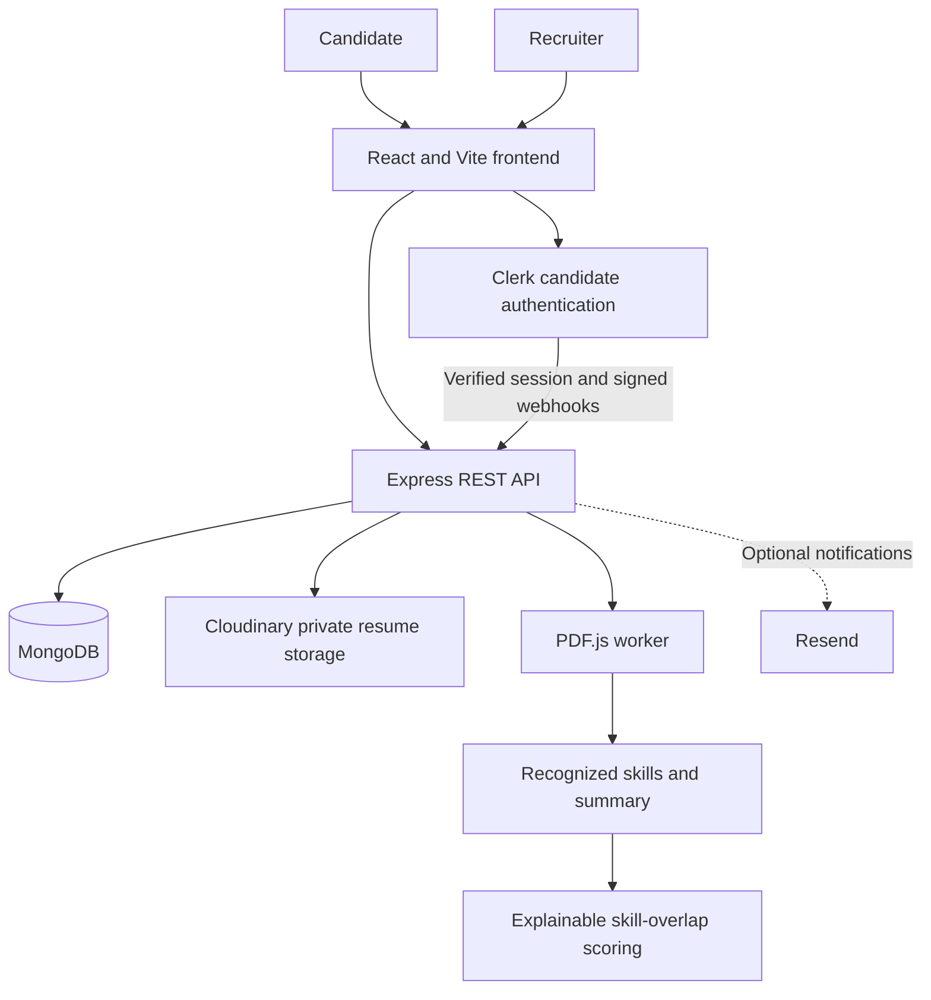
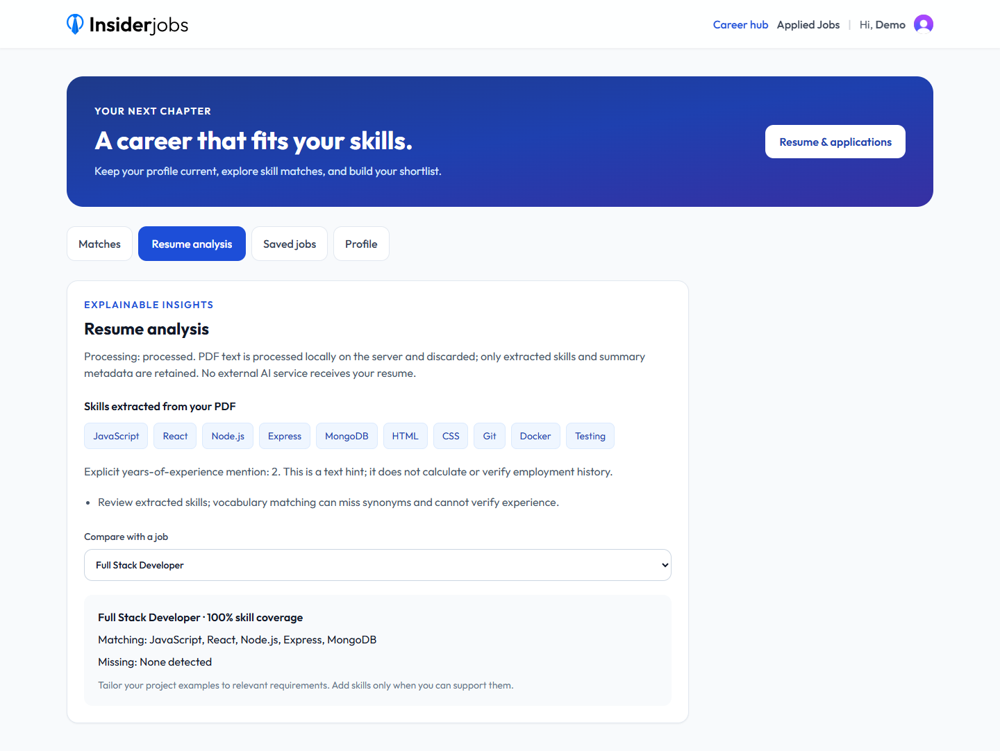
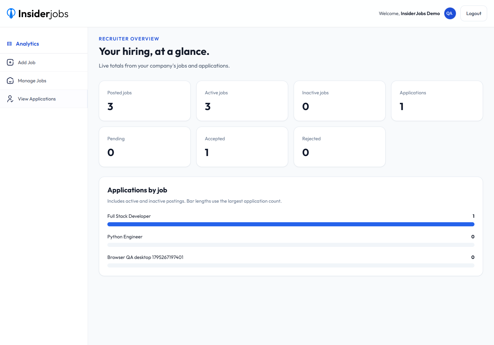

<div align="center">

# 💼 InsiderJobs — Full-Stack Job Portal

### Modern Recruitment Platform | CodeC Technologies

**React • Node.js • Express • MongoDB • Clerk • Cloudinary • Vercel**

[](https://insiderjobs-codec-technologies.vercel.app/) [](https://github.com/Priyam-Patil/Codec-Technologies-Job-Portal-System) [](https://react.dev/) [](https://www.mongodb.com/)

Discover opportunities. Understand your skills. Manage hiring in one place.

[Live Application](#live-application) · [Features](#features) · [Architecture](#architecture) · [Setup](#installation-and-setup) · [API](#api-overview) · [Testing](#testing-and-quality-assurance) · [Deployment](#deployment)

</div>

---

<a name="live-application"></a>

## 🌐 Live Application

**[Open the live website →](https://insiderjobs-codec-technologies.vercel.app/)**

[Browse the GitHub repository](https://github.com/Priyam-Patil/Codec-Technologies-Job-Portal-System)

InsiderJobs is a full-stack recruitment platform developed by **Priyam Patil** as a **CodeC Technologies** project. Job seekers can discover opportunities, manage professional profiles, upload resumes, receive explainable skill-based recommendations, and track applications. Recruiters can publish jobs, review applicants, schedule interviews, and monitor recruitment analytics.

> **Deployment note:** The frontend is deployed on Vercel; its supplied URL returned HTTP 200 during this README review. Hosted backend, MongoDB, authentication, and third-party workflows require independent verification. A reachable frontend does not establish that the complete application is production-ready.

<a name="features"></a>

## ✨ Features

### 👨‍💻 For candidates

- Sign up, sign in, and sign out securely through Clerk.
- Browse jobs, search by title and location, and open detailed descriptions.
- Filter by category, salary, experience level, job type, and remote/hybrid/onsite work mode.
- Save jobs, remove bookmarks, and hide previously applied jobs.
- Upload a PDF resume and immediately review recognized skills and experience hints.
- Explore ranked skill-based recommendations; compare matching and missing skills for a selected job.
- Manage skills, education, experience, GitHub, LinkedIn, and portfolio links.
- Apply to visible jobs, track application statuses, and view interview schedules and updates.

### 🏢 For recruiters

- Register a company and sign in with bcrypt-protected passwords and JWT authentication.
- Create, edit, and manage owned job postings; show or hide listings.
- Review applicants for company jobs and request authorized resume access links.
- Accept or reject applications, with updates available to candidates.
- Schedule interviews, change meeting details, and update interview status.
- View total/active/inactive jobs, application statuses, and applications-per-job charts using database records.

### 🔐 Security and privacy

- Clerk candidate authentication and verified recruiter JWT authorization.
- bcrypt password hashing, server-side validation, and allowlist-based HTML sanitization.
- Resource ownership checks for profiles, jobs, applications, interviews, and resume access.
- Bounded PDF uploads with file-type/signature checks and isolated parsing limits.
- Expiring authorized download links for **newly uploaded private resumes**.
- Clerk webhook signature verification against the original request body.
- Duplicate application prevention backed by the required unique MongoDB index.
- Controlled API errors, private-response cache headers, and bounded per-process request throttling.

Legacy public resume assets require a separately approved migration. Automatic index creation is disabled on normal database connections: review duplicates and obtain approval before installing an index on an existing persistent database. Local throttling is not a replacement for a shared production rate limiter.

## 🛠️ Technology Stack

| Category | Technologies |
|---|---|
| Frontend | React 19, Vite 8, JavaScript, Tailwind CSS |
| Routing | React Router |
| Backend | Node.js, Express.js |
| Database | MongoDB, Mongoose |
| Candidate authentication | Clerk |
| Recruiter authentication | JSON Web Tokens, bcrypt |
| Cloud storage | Cloudinary |
| Resume processing | PDF.js in a bounded Node.js worker |
| Job recommendations | Explainable skill-overlap scoring |
| API communication | Axios, REST APIs |
| Testing | Playwright, Node.js Test Runner |
| Frontend hosting | Vercel |
| Version control | Git, GitHub |

<a name="architecture"></a>

## 🏗️ Architecture

The React/Vite frontend communicates with a separate Express REST API. MongoDB stores application data; Clerk manages candidate identity, while recruiter credentials use bcrypt and JWTs.



Candidate API identity comes from the verified Clerk session. Recruiter requests use the existing JWT header flow, and database queries enforce ownership. The production API entry point exports a lazy-connection handler for serverless use while retaining normal Node.js startup.

## 🧠 Resume Analysis and Skill-Based Matching

InsiderJobs uses an **explainable, rule-based recommendation system**, with no trained prediction model, generative AI, or external LLM integration.

### How it works

1. The candidate uploads a PDF resume, up to **5 MB**.
2. The backend validates the document before processing or storage.
3. PDF.js extracts embedded readable text inside a worker with time and memory limits.
4. A curated vocabulary identifies recognized skills and explicit experience mentions.
5. Recognized resume skills and manually supplied profile skills are compared with skills found in visible job titles and descriptions.
6. Unapplied jobs are ranked by skill coverage, with posting recency used to break ties.

### Matching formula

**Match Score (%) = (Matched Recognized Job Skills ÷ Total Recognized Job Skills) × 100**

For a job requiring **React, Node.js, MongoDB, and JavaScript**, a candidate matching three of those four recognized skills receives **3 ÷ 4 × 100 = 75%** skill coverage. Matching and missing skills are shown alongside the score.

The score measures recognized skill overlap; it is **not a hiring probability, verified qualification, or guarantee of suitability**. A job with no recognized requirements receives no numeric score. With no recognized candidate skills, the application explains the fallback and shows jobs by recency.

Only extracted skills and summary metadata are retained; full extracted text is discarded. No external AI service receives the resume. Experience mentions are unverified text hints. Scanned PDFs have no OCR support; candidates can add profile skills when embedded text cannot be read.

## 📸 Screenshots

<details>
<summary><strong>View resume analysis and recruiter analytics</strong></summary>

These screenshots come from executed **local QA sessions using isolated test data**, not a claim of hosted integration verification.

**Resume analysis and recognized skill coverage**



**Recruiter analytics and applications per job**



</details>

## 📂 Project Structure

```text
Codec-Technologies-Job-Portal-System/
├── client/
│   ├── src/
│   │   ├── assets/
│   │   ├── components/
│   │   ├── context/
│   │   ├── lib/
│   │   └── pages/
│   ├── tests/
│   ├── package.json
│   └── vercel.json
├── server/
│   ├── config/
│   ├── controllers/
│   ├── middleware/
│   ├── models/
│   ├── routes/
│   ├── utils/
│   ├── scripts/
│   ├── tests/
│   ├── e2e/
│   ├── app.js
│   ├── server.js
│   ├── package.json
│   └── vercel.json
├── docs/
│   ├── screenshots/
│   ├── CHECKLIST_138_COVERAGE.md
│   ├── DEMO_GUIDE.md
│   └── DEPLOYMENT.md
└── README.md
```

The tree shows selected existing source and documentation paths; dependencies, local databases, credentials, and generated output are excluded.

<a name="installation-and-setup"></a>

## ⚙️ Installation and Setup

### Prerequisites

- Node.js **22.13+ in the 22.x line, or Node.js 24+**; use a compatible supported runtime for hosting.
- npm and access to an authorized development MongoDB database.
- Clerk and Cloudinary accounts configured for development/testing.

### 1. Clone the repository

```bash
git clone https://github.com/Priyam-Patil/Codec-Technologies-Job-Portal-System.git
cd Codec-Technologies-Job-Portal-System
```

### 2. Install backend dependencies

```bash
cd server
npm ci
```

### 3. Install frontend dependencies

From the backend directory:

```bash
cd ../client
npm ci
```

### 4. Configure frontend variables manually

For a **new clone**, configure the following in `client/.env`, or use the project's existing `client/.env.local`. Vite gives local overrides precedence; avoid conflicting duplicate settings.

```env
VITE_CLERK_PUBLISHABLE_KEY=your_clerk_publishable_key
VITE_BACKEND_URL=http://localhost:5000
```

### 5. Configure backend variables manually

For a new clone, configure `server/.env` with your own authorized development credentials:

```env
PORT=5000
MONGODB_URI=your_mongodb_connection_string
JWT_SECRET=your_secure_jwt_secret
CLOUDINARY_NAME=your_cloudinary_cloud_name
CLOUDINARY_API_KEY=your_cloudinary_api_key
CLOUDINARY_SECRET_KEY=your_cloudinary_secret_key
CLERK_PUBLISHABLE_KEY=your_clerk_publishable_key
CLERK_SECRET_KEY=your_clerk_secret_key
CLERK_WEBHOOK_SECRET=your_clerk_webhook_secret
```

Optional backend configuration:

```env
ALLOWED_ORIGINS=http://localhost:5173
RESEND_API_KEY=your_optional_resend_api_key
EMAIL_FROM=your_verified_sender_address
SENTRY_DSN=your_optional_sentry_dsn
```

> Examples contain placeholders only. Preserve existing environment files and values in an established workspace. Never commit real environment files, secrets, database connection strings, private uploads, or generated account manifests. Set allowed origins to the exact frontend origin printed by Vite. Email requires both credentials and a verified sender; leave it unconfigured when not needed.

### 6. Start the backend

In one terminal, from the repository root:

```bash
cd server
npm run server
```

Default API: [http://localhost:5000](http://localhost:5000)

Health endpoint: [http://localhost:5000/health](http://localhost:5000/health)

The health endpoint returns HTTP 200 only when MongoDB is connected; database unavailability produces a controlled failure response.

### 7. Start the frontend

In a separate terminal, from the repository root:

```bash
cd client
npm run dev
```

Open the local URL printed by Vite. The frontend and backend must use the same Clerk instance, and the configured API URL and CORS origins must agree.

<details>
<summary><strong>Optional: persistent local demonstration on ports 5175 / 5000</strong></summary>

With existing Clerk **development** and Cloudinary configuration, the project can run with a persistent local MongoDB process instead of connecting to the configured remote database:

```bash
cd server
npm run dev:local:all
```

This starts the frontend at [http://127.0.0.1:5175](http://127.0.0.1:5175) and backend at [http://127.0.0.1:5000](http://127.0.0.1:5000). It preserves local database files, seeds no accounts or jobs, disables outbound email for that process, and does not rewrite environment files. Do not start a second backend on the same port. See the [demo guide](docs/DEMO_GUIDE.md) for isolated accounts and test data.

</details>

<a name="api-overview"></a>

## 🔌 API Overview

### Public APIs

| Method | Endpoint | Purpose |
|---|---|---|
| GET | `/health` | Backend and MongoDB readiness |
| GET | `/api/jobs` | Browse visible jobs |
| GET | `/api/jobs/:id` | View a visible job's details |

### Candidate APIs

Candidate requests require a verified Clerk Bearer token and access the signed-in candidate's data.

| Method | Endpoint | Purpose |
|---|---|---|
| GET | `/api/users/user` | Read or initialize the candidate profile |
| PUT | `/api/users/profile` | Update permitted profile fields |
| POST | `/api/users/apply` | Apply for a visible job |
| GET | `/api/users/applications` | View own applications and interviews |
| POST | `/api/users/update-resume` | Upload a PDF in multipart field `resume` |
| GET | `/api/users/resume` | Request an authorized resume download link |
| GET | `/api/users/recommendations` | Ranked recommendations; optional `jobId` comparison |
| GET | `/api/users/saved-jobs` | List saved visible jobs |
| PUT | `/api/users/saved-jobs/:id` | Save a job without duplicate bookmarks |
| DELETE | `/api/users/saved-jobs/:id` | Remove a saved job |

### Recruiter APIs

Registration and login are public and throttled. Other company routes require a recruiter JWT in the existing `token` header or supported Bearer flow and enforce ownership.

| Method | Endpoint | Purpose |
|---|---|---|
| POST | `/api/company/register` | Register a recruiter/company; multipart logo field `image` |
| POST | `/api/company/login` | Recruiter login |
| GET | `/api/company/company` | Read the authenticated company |
| POST | `/api/company/post-job` | Create a job |
| GET | `/api/company/list-jobs` | List owned jobs |
| PUT | `/api/company/jobs/:id` | Edit an owned job |
| PUT | `/api/company/change-visibility` | Toggle owned job visibility |
| GET | `/api/company/applicants` | View applicants for owned jobs |
| GET | `/api/company/applications/:id/resume` | Request authorized applicant resume access |
| PUT | `/api/company/change-status` | Update an owned application status |
| PUT | `/api/company/interviews/:id` | Schedule or update an interview |
| GET | `/api/company/analytics` | Recruiter-specific counts and chart data |

**Identity webhook:** `POST /webhooks` verifies Clerk/Svix signatures over the raw body. See the [complete endpoint audit](docs/COMPLETE_API_ENDPOINT_AUDIT.md) for wider verification evidence.

<a name="testing-and-quality-assurance"></a>

## 🧪 Testing and Quality Assurance

The project includes functional, isolated API integration, regression, and real-browser tests. Test scopes and external-service limitations are documented separately.

### Functional checklist coverage

| Metric | Reported Result |
|---|---|
| Total test criteria | **138** |
| Functional sections | **17** |
| Criteria with passing evidence | **138** |
| Failed criteria | **0** |
| Blocked criteria within checklist | **0** |

The 138-case checklist combines retained test evidence and additional real-browser scenarios. It does **not** mean 138 independent test functions were rerun against the hosted production deployment. Viewport repetitions do not increase the checklist denominator; mocked or deliberately injected failures are not counted as live-service successes.

### Covered areas

- Homepage/navigation; Clerk candidate authentication and recruiter login.
- Job searching/filtering, PDF upload/extraction, analysis, and skill-based matching.
- Candidate profiles, saved jobs, applications, and status tracking.
- Recruiter job/applicant management, interviews, and analytics.
- Ownership/security, responsive layouts, recovery, and cross-account demonstrations.

### Testing commands

Run each block from the repository root.

**Backend**

```bash
cd server
npm test
npm run test:integration
npm run check
```

**Frontend**

```bash
cd client
npm test
npm run lint
npm run build
```

**Live browser tests**

```bash
cd server
npm run test:e2e:live
```

Live tests need configured development services and isolated accounts/data; consult the [demo guide](docs/DEMO_GUIDE.md) before running them. API integration tests use a real isolated MongoDB process with explicitly identified authentication/transport test seams; they do not prove live Clerk, Cloudinary, or email delivery.

### External integration checks

Five external checks remained blocked in the latest local QA report: **Google OAuth**, **three email notification workflows** (application, status, interview), and **live Clerk webhook delivery**. Hosted backend and MongoDB readiness require separate verification.

### QA documentation

- [Exact 138-case coverage and evidence](docs/CHECKLIST_138_COVERAGE.md)
- [Resumed browser testing report](docs/RESUMED_TESTING_REPORT.md)
- [Strict live browser results](docs/LIVE_BROWSER_E2E_RESULTS.md)
- [Independent end-to-end audit](docs/FINAL_E2E_AUDIT.md)
- [Demo guide](docs/DEMO_GUIDE.md)
- [Deployment checklist](docs/DEPLOYMENT.md)
- [Publication and release checks](docs/RELEASE_READINESS.md)

<a name="deployment"></a>

## 🌍 Deployment

### Frontend — Vercel

**[insiderjobs-codec-technologies.vercel.app](https://insiderjobs-codec-technologies.vercel.app/)**

| Configuration | Value |
|---|---|
| Framework | Vite |
| Root Directory | `client` |
| Build Command | `npm run build` |
| Output Directory | `dist` |

Configure the following manually in the appropriate Vercel environment:

```env
VITE_CLERK_PUBLISHABLE_KEY=your_clerk_publishable_key
VITE_BACKEND_URL=https://your-backend.example.com
```

The deployed API URL must point to a publicly reachable **HTTPS backend**, not localhost. Match backend allowed origins and Clerk domain settings to the deployed frontend. Local environment files do not configure Vercel automatically.

### Backend and database

The Express backend requires compatible Node.js hosting or a correctly configured serverless deployment. The existing `server/vercel.json` and exported API handler are retained; hosted worker packaging, runtime/request limits, CORS, and authentication still need verification in the chosen environment.

MongoDB must be reachable from the deployed backend. The last release check reported a DNS failure for the configured remote database; use an authorized staging connection and recheck connectivity. Keep MongoDB credentials, Clerk secret keys, JWT secrets, Cloudinary secret keys, and optional email credentials **on the server side**.

Before production promotion, verify hosted `/health`, actual frontend-to-backend requests, MongoDB persistence/indexes, authentication/ownership, private resume upload/download, and the complete candidate/recruiter workflows. A passing local build or reachable homepage is not production certification. See [deployment instructions](docs/DEPLOYMENT.md) and [remaining blockers](docs/REMAINING_BLOCKERS.md).

## 🚀 Future Enhancements

- Complete hosted OAuth, email, webhook, backend, and database verification.
- Strengthen recruiter session management, recovery, and revocation.
- Add shared rate limiting, database-side search, and pagination for scaling.
- Expand resume vocabulary and evaluate OCR with explicit privacy controls.
- Extend recruiter analytics and cross-browser/accessibility testing.
- Add production monitoring, backups, retention policies, and operational checks.

## 👨‍💻 Developer

**Priyam Patil** · **CodeC Technologies**

Project: **InsiderJobs — Full-Stack Job Portal**

[GitHub Profile](https://github.com/Priyam-Patil) · [Project Repository](https://github.com/Priyam-Patil/Codec-Technologies-Job-Portal-System) · [Live Demo](https://insiderjobs-codec-technologies.vercel.app/)

## ⭐ Support

If this project is useful, consider starring the repository.

Built with React, Express, MongoDB, Clerk, and Cloudinary.
