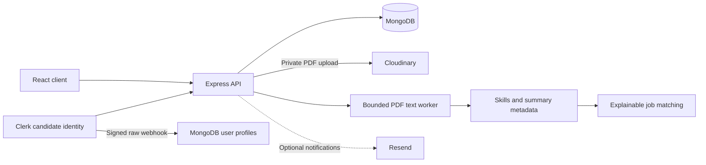

# InsiderJobs — Full-Stack Job Portal

**Latest checklist:** [138 original criteria with evidence](docs/CHECKLIST_138_COVERAGE.md), [resumed browser report](docs/RESUMED_TESTING_REPORT.md), and [publication/preview release checks](docs/RELEASE_READINESS.md). The five external integration blockers are separate from those 138 local checklist criteria. Hosted readiness is not implied.

**Strict live-only E2E:** see [LIVE_BROWSER_E2E_RESULTS.md](docs/LIVE_BROWSER_E2E_RESULTS.md) for the latest mock-free workflow run, actual Clerk UI registration, privacy/status lifecycle checks, built-in Codex browser checks and explicit external blockers. Run `npm run test:e2e:live` from `server`. The separate network-regression suite intentionally injects failures and is not counted as live integration evidence.

An existing MERN job portal enhanced with explainable resume recommendations, candidate profiles, saved jobs, recruiter analytics and interviews. Candidates use Clerk; recruiters retain bcrypt and JWT authentication. MongoDB stores application data and Cloudinary stores uploaded assets.

**Current verification:** see the [independent end-to-end audit](docs/FINAL_E2E_AUDIT.md), [feature checklist](docs/WORKING_FEATURES_CHECKLIST.md) and [bug-fix report](docs/BUG_FIX_REPORT.md). Real Clerk development sign-in/logout, authenticated Cloudinary PDF upload/download, immediate extracted resume skills, candidate/recruiter workflows and persistent local MongoDB were executed. Configured remote MongoDB connectivity, email, live webhook ingress and hosted deployment remain blocked/unverified. The [demo guide](docs/DEMO_GUIDE.md) provides exact commands for the persistent local app on **5175/5000** and isolated browser audit.

See [initial audit](docs/INITIAL_AUDIT.md), [verification and final report](docs/FINAL_REPORT.md), and [deployment checklist](docs/DEPLOYMENT.md).

Earlier network-regression verification: **54/54 Chrome desktop/tablet/mobile cases (includes deliberately injected faults; not 54 live-service passes)**, **14 backend unit/network + 18 isolated API tests**, **3 frontend tests**, lint/build and syntax pass. All **28 explicit endpoint contracts** were exercised locally. Restart-persistence and repeated frontend/API/auth checks pass. Start both local services with `npm run dev:local:all` from `server`. See [network root causes](docs/NETWORK_ERROR_ROOT_CAUSE.md), [complete endpoint audit](docs/COMPLETE_API_ENDPOINT_AUDIT.md) and [network regressions](docs/NETWORK_REGRESSION_TESTS.md). Configured remote MongoDB and external deployment gates remain blocked/unverified.

## Features

| Candidate | Recruiter |
|---|---|
| Clerk account and logout | Company signup and bcrypt/JWT login |
| Title, location, category, salary and level filters | Post, edit and show/hide owned jobs |
| Job type and work-mode filters | View owned applications and resolve resume links |
| Apply once; review status and interviews | Accept/reject applications; schedule/update interviews |
| PDF resume upload and skill extraction | Real database totals and applications-per-job chart |
| Explainable ranked matches and job comparison | Optional application/status/interview emails |
| Profile education, experience and professional links | Resource ownership enforced in API queries |
| Persistent saved jobs and applied-job exclusion | Accessible status and interview controls |

New screens: `/career`, `/dashboard/analytics`, `/dashboard/edit-job/:id`. Existing URLs and response envelopes remain compatible. HTTP errors now use appropriate status codes.

## Technology

- **Frontend:** React 19, Vite 8, React Router 7, Tailwind 3, Axios, Clerk React, Quill, Moment, React Toastify.
- **Backend:** Node.js ES modules, Express 5, Mongoose 9/MongoDB, Clerk Express, bcrypt, JSON Web Tokens, Multer, Cloudinary, Svix.
- **Analysis:** PDF.js in a bounded worker, deterministic skill vocabulary, explainable skill-overlap scoring. No paid AI API, embeddings or trained prediction model.
- **Security/QA:** sanitize-html, bounded in-memory throttles, Node's test runner, mongodb-memory-server. Sentry remains available as opt-in telemetry.

## Architecture



`server/app.js` creates the API without connecting to services. `server/server.js` retains local startup and exports a lazy-connection Vercel handler. `client/src/context/AppContext.jsx` coordinates existing authentication and application state; candidate state resets on identity changes.

## Resume analysis and matching

1. An authenticated candidate uploads a PDF, limited to 5 MB. MIME type, extension and PDF signature are checked before upload.
2. PDF.js extracts at most 100,000 text characters from at most 20 pages inside a worker with a 12-second deadline and a 128 MB JavaScript heap limit. Damaged or encrypted PDFs are rejected before upload. Valid scanned, textless or processing-limited PDFs have an honest unreadable/manual-skills fallback. Upload success immediately displays PDF-only extracted skills and summary metadata; profile skills are separate.
3. A curated vocabulary recognizes skills and aliases with token boundaries. Explicit “N years” mentions provide an **unverified text hint**, not calculated employment tenure.
4. The original PDF is uploaded to Cloudinary as an authenticated raw asset. MongoDB stores only the asset metadata, recognized skills, experience hint and suggestions. Extracted full text is discarded after the request; no resume goes to an external AI service.
5. Recognized resume and profile skills are compared with the title and description of visible, unapplied jobs.

**Score = 100 × matched recognized job skills / total recognized job skills**, rounded to an integer. Repetition does not increase a skill's weight. No recognized requirements yields a null score. Ties use posting recency. With no candidate skills, the API explains the fallback and orders jobs by recency. The top 30 are returned.

Scores measure vocabulary overlap. They do not establish suitability, hiring probability or match accuracy. Negated requirements, proficiency, chronology, synonyms outside the vocabulary and job context need human review. Missing skills are suggestions for learning, not instructions to misrepresent experience. Existing resumes need re-uploading for extraction; manual profile skills work immediately.

## Local setup

Use Node **22.13+ in the 22.x line, or 24+**; Node 24 LTS is recommended for deployment. Current checks ran on Node 26.13.1 on Windows. MongoDB integration tests download a temporary local MongoDB binary on first use.

Install dependencies:

```powershell
cd server
npm ci
cd ../client
npm ci
```

Existing environment files are confidential and must be kept unchanged. No environment template was created. Configure missing values manually in your own local or hosting settings; never paste secrets into source or commit them.

| Existing variable name | Location / purpose |
|---|---|
| `MONGODB_URI` | Server MongoDB connection; use a dedicated development database locally |
| `JWT_SECRET` | Server recruiter JWT signing secret |
| `CLERK_SECRET_KEY`, `CLERK_PUBLISHABLE_KEY` | Server Clerk middleware, as required by the SDK |
| `CLERK_WEBHOOK_SECRET` | Server Svix webhook verification; existing name preserved |
| `CLOUDINARY_NAME`, `CLOUDINARY_API_KEY`, `CLOUDINARY_SECRET_KEY` | Server Cloudinary configuration; existing names preserved |
| `PORT` | Optional local API port; defaults to 5000 |
| `VITE_BACKEND_URL` | Client API base URL; publicly bundled value |
| `VITE_CLERK_PUBLISHABLE_KEY` | Client Clerk publishable key; publicly bundled by design |

Additional optional configuration, **not created automatically**:

| Variable | Manual configuration |
|---|---|
| `ALLOWED_ORIGINS` | Server comma-separated exact frontend origins. Set for deployment; unset preserves broad origin compatibility. |
| `RESEND_API_KEY` | Server API credential, only if you elect to enable Resend notifications. |
| `EMAIL_FROM` | Server sender on a manually verified sending domain. Both email settings are required. |
| `SENTRY_DSN` | Server opt-in telemetry. Replaces an embedded telemetry destination; no environment value was changed. |

Run `npm run server` in `server`, and `npm run dev` in `client`. The normal backend reads its existing configuration; **do not start it against production for testing**. Clerk webhooks must deliver `user.created`, `user.updated` and `user.deleted` to `/webhooks` using the same Clerk instance as the client. Name/email remain Clerk-managed; education, skills, experience and professional URLs are MongoDB fields.

For a disposable public/recruiter QA environment, run `node scripts/preview-isolated.js` from `server`. It creates only local temporary records and uses an explicit test API in Vite memory. The test recruiter is `qa@example.test` / `qa-preview-password`; these are disposable test credentials only. Candidate login is intentionally unavailable in that harness. Stop it with Ctrl+C. The harness is never imported by production startup.

For the complete **real Clerk/Cloudinary browser demo**, use `npm run demo` from `server` instead. It starts all three local services, creates reserved development test accounts, and keeps credentials in ignored `.qa/demo-session.json`. See [DEMO_GUIDE.md](docs/DEMO_GUIDE.md) for login, reset, cleanup and the complete walkthrough. Run `npm run test:e2e` for desktop/mobile Playwright coverage. The original anonymous preview helper above is retained for compatibility; it is not evidence of live candidate authentication.

## Database design and safe index setup

- **User:** Clerk string ID, synchronized identity, resume URL and asset metadata, extracted summary, profile fields, saved Job ObjectIds. Bookmarks use `$addToSet` / `$pull`.
- **Company:** name/email/image and hashed recruiter password; passwords are excluded from responses.
- **Job:** existing title, rich description, location, category, level, salary, date, visibility and company ID; optional `jobType` and `workMode`. Old records keep unspecified fields rather than fabricated values.
- **JobApplication:** candidate/company/job IDs, bounded status, date, optional interview date/details/status.

The schema declares a unique `{ userId: 1, jobId: 1 }` index. **Automatic index creation is disabled on normal database connections.** Existing duplicate records are never deleted or migrated automatically. The race-safe application guarantee requires the real index to be installed.

`npm run db:check-indexes` is a read-only report against the manually selected database. It prints counts only. Review duplicates and backups yourself. After approval for that database, `npm run db:check-indexes -- --apply` creates the index only when there are no duplicate groups. This command was **not run against the configured database**. It never resolves duplicates automatically.

## API overview

| Method and path | Access / purpose |
|---|---|
| `GET /api/jobs`, `/api/jobs/:id` | Public visible jobs with public company fields only |
| `POST /api/company/register`, `/login` | Throttled recruiter signup/login |
| `GET /api/company/company`, `/list-jobs`, `/applicants`, `/analytics` | Recruiter-owned records and aggregates |
| `POST /api/company/post-job` | Recruiter posting |
| `PUT /api/company/jobs/:id` | Recruiter-owned job edit |
| `PUT /api/company/change-visibility`, `/change-status` | Ownership-checked updates |
| `PUT /api/company/interviews/:id` | Schedule/update an owned application interview |
| `GET /api/company/applications/:id/resume` | Ownership check then expiring resume link |
| `GET /api/users/user`, `/applications`, `/resume` | Authenticated candidate's own data |
| `POST /api/users/apply`, `/update-resume` | Candidate application / bounded PDF upload |
| `PUT /api/users/profile` | Whitelisted profile fields; identity is immutable here |
| `GET /api/users/recommendations?jobId=...` | Ranked jobs and optional selected-job comparison |
| `GET /api/users/saved-jobs` | Visible saved jobs |
| `PUT`, `DELETE /api/users/saved-jobs/:id` | Idempotent save/remove |
| `POST /webhooks` | Raw-body Svix signature verification and idempotent identity upsert |
| `GET /health` | Application liveness endpoint; deployed wrapper requires DB readiness |

Candidate APIs accept Clerk Bearer tokens. Recruiter APIs accept the existing `token` header or Bearer JWT. Normal JSON responses use `success` and a message or payload. Private routes send `Cache-Control: no-store`. The development-only `/debug-sentry` endpoint returns 404 outside explicit development mode.

## Tests

```powershell
cd server
npm test
npm run test:integration
npm run check
cd ../client
npm run lint
npm run build
```

Unit tests cover vocabulary boundaries, scoring, sanitization, validation, PDF extraction/fallback, throttling and notification outcomes. Integration tests create an isolated MongoDB process, use actual Mongoose queries and indexes, and verify reads after writes, concurrent applications, ownership, profiles, bookmarks, status, interviews, login and signed webhooks. Clerk identity is substituted only at the integration test seam; the production server uses Clerk middleware. Cloudinary upload and email transports are stubbed to avoid external modifications. No test imports dotenv or connects to your configured MongoDB URI.

Real Chrome tests run against normal local server processes. See [FINAL_E2E_AUDIT.md](docs/FINAL_E2E_AUDIT.md) for the current desktop/tablet/mobile results, screenshots, restart persistence, live-service evidence and remaining blockers. Earlier reports are retained as historical evidence.

## Security, limitations and next work

- JWTs allow HS256 only and enforce expiry. Recruiters cannot query or mutate another company's resources. Candidate identity always comes from Clerk, never a submitted user ID.
- Resume links for new authenticated assets expire after two minutes. Candidate and recruiter ownership are checked before signing. **Legacy public Cloudinary URLs remain public** until you approve a migration. Re-upload for private storage; old assets are not automatically deleted.
- Job HTML is allowlist-sanitized on write and read, including old stored content. Job cards use escaped text. Profile URLs require HTTPS; GitHub/LinkedIn hosts are checked.
- Uploads use bounded memory, no temporary disk files. Signature checks do not replace malware scanning. PDF extraction has worker/heap/deadline limits; no OCR or DOCX parsing.
- Email is optional and synchronous with a five-second timeout; failures do not roll back applications/statuses. The API reports `sent`, `failed`, `not_configured` or related outcomes. Durable outbox/retry/delivery receipts are future work; do not treat provider acceptance as confirmed inbox delivery.
- Local throttles are per process. Use a shared limiter or platform WAF before scaling serverless traffic. CORS is not authorization.
- Recruiter tokens remain in localStorage for compatibility, with the existing 30-day expiry. Consider HttpOnly cookies, revocation and recovery before public launch. Recruiter password recovery and admin moderation are not implemented.
- Filters operate on fetched visible jobs; database-side pagination/search and more scalable recommendation retrieval are next steps. Salary retains existing CTC semantics without inventing currency or pay period.
- Profile fields are candidate-authored; they are not verified qualifications. The matching score is not suitable for automated hiring decisions.
- At the final dependency scan: no production backend advisories; two moderate advisories remain in the development-only nodemon/minimatch chain. Frontend has one low Quill HTML-export advisory; HTML persistence/display is independently sanitized. No forced breaking fixes were applied.
- Desktop/mobile Chrome, Clerk development authentication and live authenticated resume delivery have been verified. Physical devices, Safari, complete keyboard focus trapping, live webhook ingress and Vercel worker packaging need further QA. No push or deployment occurred. Live-service tests create only disposable Clerk development users and run-scoped Cloudinary QA assets.

For interviews, demonstrate the score calculation and failure paths, ownership tests, concurrent duplicate test, raw webhook verification and the actual MongoDB analytics pipeline. Describe external-service and deployment verification limits openly.

## Implementation references

The upload and signing approach follows [Cloudinary access-control documentation](https://cloudinary.com/documentation/control_access_to_media). PDF extraction uses the [PDF.js API](https://mozilla.github.io/pdf.js/api/draft/module-pdfjsLib.html). Raw webhook verification follows [Clerk's Express webhook guidance](https://github.com/clerk/skills/blob/main/skills/features/clerk-webhooks/references/frameworks.md). The optional email request uses [Resend's send-email API](https://resend.com/docs/api-reference/emails/send-email).
